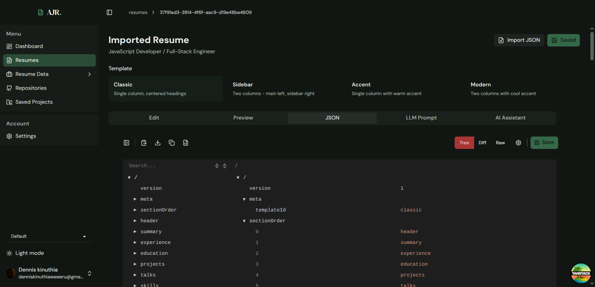

# CraVfted

Résumé as typed JSON. Tweak it with any LLM, edit it by hand. Export a clean PDF, same result every time. Store sections individually so you can reuse and remix them later, reassemble everything back into a polished PDF whenever you need.

---

## What is this?

The usual résumé workflow sucks. You tailor it for a job, paste it into Google Docs or Word, spend an hour making the formatting look right, and six months later you need a different version and can't remember what changed. Or you ask an LLM to rewrite it, get back a pile of text, and do the whole formatting dance over again.

This keeps your résumé as JSON — structured sections you own entirely. You can feed the whole thing (or just the parts you want) into any LLM alongside a job description and get back revised JSON that fits the same schema. You can edit it in the app, by hand in a text editor, wherever. When you export, it's the same PDF layout every time because the layout is code, not a document.

The real win is that sections stay separate. Your experience section is its own block, your skills are their own block. You can shuffle them around, copy them between versions, or build a totally different resume from the same source data. Export whatever you need whenever you need it.

No vendor lock-in, no waiting for some background service, no proprietary format. Just JSON and React components that turn it into a PDF.

---




## What's in the app

- **Résumé builder** — sections (experience, education, skills, certifications, projects, talks, volunteering, languages, links) stored as individual records and assembled into a typed JSON document.
- **PDF export** — client-side rendering with `@react-pdf/renderer`; the layout is code, so exports are deterministic.
- **AI assistant** — job-fit analysis, summary rewrites, tailored drafts (see [AI Assistant](#ai-assistant)).
- **Job tracking** — save job postings, rank résumés and library sections against them by keyword coverage.
- **Cover letters & application answers** — first-class sections with their own AI tools.
- **Public résumés** — share a read-only view at `/r/{publicId}`.
- **GitHub integration** — pull your repos in as source material for projects.

## Stack

| Layer         | Choice                                                                     |
| ------------- | -------------------------------------------------------------------------- |
| Monorepo      | pnpm workspaces + Turbo                                                    |
| App framework | TanStack Start (SSR-capable React 19 + compiler)                           |
| Routing       | TanStack Router (file-based)                                               |
| Data fetching | TanStack Query + TanStack DB (local collections)                           |
| API           | Nest (`apps/nest`) for product/auth/AI; Hono (`apps/api`) for legacy tools |
| Database      | Drizzle ORM on Postgres: native local dev, PGBoxDB disposable tests        |
| Auth          | Better Auth (GitHub OAuth)                                                 |
| AI            | TanStack AI + OpenRouter (BYO key)                                         |
| PDF           | `@react-pdf/renderer`                                                      |
| Styling       | Tailwind CSS v4 + DaisyUI tokens + shadcn/ui                               |
| Testing       | Vitest (unit) + Playwright (e2e)                                           |
| Tooling       | Vite+ (`vp` CLI)                                                           |

## Repo layout

| Path                         | Role                                                            |
| ---------------------------- | --------------------------------------------------------------- |
| `apps/web`                   | TanStack Start app: UI, routes, local collections, PDF pipeline |
| `apps/nest`                  | Nest API: auth, sync, admin, agentic REST/RPC, hosted AI        |
| `apps/api`                   | Legacy Hono API and oRPC/OpenAPI tool surface                   |
| `apps/aws`                   | CDK deployment for the legacy API                               |
| `packages/db`                | Drizzle Postgres schema and migrations                          |
| `packages/isomorphic`        | Pure logic shared by web and Nest                               |
| `packages/ui`                | Shared React components                                         |
| `packages/typescript-config` | Shared tsconfig presets                                         |

Data flow: the browser keeps sections in local TanStack DB collections and syncs events to Nest; Nest owns auth, server reads/writes, admin, credits, public résumés, and hosted AI orchestration. Browser-hosted AI tools stay in the web app.

## Getting started

```bash
pnpm install
pnpm --filter nest start   # Nest on :5040
pnpm --filter web dev      # web on :3040
```

### Local databases — read this before running tests

There are three distinct database modes. Do not mix them up.

**1. Persistent dev database (native Postgres, never Docker).**
The local Postgres server on `:5432` has a `dennis` role and an
`agentic_json_resume_nest` database. `apps/nest/.env` already points at it over
TCP with a local-only dummy credential; nothing here is shipped to production.
Check it and apply migrations with:

```bash
psql "$(grep '^POSTGRES_URL=' apps/nest/.env | cut -d= -f2-)" -c 'select 1'
POSTGRES_URL="$(grep '^POSTGRES_URL=' apps/nest/.env | cut -d= -f2-)" \
  pnpm --filter @repo/db db:migrate:postgres
```

**2. Disposable test databases (PGBoxDB, never Docker).**
PGBoxDB is installed as a root dev dependency and its agent skill lives at
`.agents/skills/pgboxdb`. Start the runtime once and run Nest E2E through it:

```bash
pnpm exec pgboxdb run                  # picks/keeps its own port; use PGBOXDB_PORT=55430 on a fresh home
pnpm --filter nest test:e2e:pgbox      # all core E2E, no Docker
pnpm --filter nest test:e2e:pgbox -- test/ai
```

The wrapper reads the connection URL from `pgboxdb run --json` and passes it to
Vitest as `NEST_TEST_POSTGRES_URL`; it never prints or commits the URL. Tests
create and drop their own databases inside PGBoxDB. The real-data admin suites
need `NEST_TEST_POSTGRES_SOURCE` pointed at a migrated snapshot; when it is not
set, the wrapper skips those suites automatically.

**3. Docker is only the final shipping gate.**
Do not start Docker for routine tests or migrations. Build the two images and
smoke-test them only when validating the deployable artifact:

```bash
docker build -f apps/nest/Dockerfile -t ajr-nest:cloudrun-test .
docker build -f apps/web/Dockerfile \
  --build-arg VITE_API_ORIGIN="$NEST_ORIGIN" \
  --build-arg VITE_API_URL="$WEB_ORIGIN" \
  -t ajr-web:cloudrun-test .
```

See `docs/cloud-run-staging.md` for the full staging runbook.

### Agent directive

When a task needs a database, use the installed PGBoxDB skill
(`.agents/skills/pgboxdb`) and the `pgboxdb` CLI for anything disposable. Use
the native Postgres only for the persistent dev database. Never start Docker
for tests, migrations, or local development. Do not read `~/.pgboxdb/config.json`
to discover PGBoxDB credentials — use `pgboxdb --json status` or
`pgboxdb --json url` instead. The native dev credential in `.env.example` is a
local-only dummy and is the one exception. Never import data from a
remote/sensitive database without explicit approval; schema-only is the
default.

## Scripts

| Command                             | What it does                   |
| ----------------------------------- | ------------------------------ |
| `pnpm dev`                          | Turbo dev (web + api)          |
| `pnpm build`                        | Build all packages and apps    |
| `pnpm lint`                         | `vp lint` (deny warnings)      |
| `pnpm format`                       | `vp fmt`                       |
| `pnpm test`                         | Vitest unit tests              |
| `pnpm test:e2e`                     | Playwright e2e                 |
| `pnpm --filter nest test:e2e:pgbox` | Nest E2E on disposable PGBoxDB |
| `pnpm check-types`                  | Typecheck all packages         |
| `pnpm quality`                      | Lint + format check            |

Use **`vp`** from the repo root for per-task lint/format/test (e.g. `vp check`).

## AI Assistant

The resume workbench has a built-in AI assistant that can analyze job fit, rewrite summaries, and plan tailored drafts.

**No server-side API keys are stored.** You bring your own key:

1. Open any resume and go to the **AI** tab.
2. Expand **AI Provider Settings**, paste your [OpenRouter API key](https://openrouter.ai/keys), and pick a model.
3. Choose whether the key is stored in `localStorage` (persists across tabs) or `sessionStorage` (cleared on tab close).
4. For hosted OpenRouter chat, the key is sent to this app's server for the duration of each AI request, forwarded to OpenRouter, and never persisted server-side.

See `apps/web/src/features/agentic-tools/README.md` for the full AI layer reference.

## Docs

- `VISION.md` — product problem, JSON+LLM loop, future "agentic" direction.
- `ARCHITECTURE.md` — how the repo is organized.
- `CLAUDE.md` — agent guide: stack rules, code conventions, tooling.
- `docs/cloud-run-staging.md` — final-stage image build and deployment runbook.
- `.agents/skills/pgboxdb/SKILL.md` — disposable Postgres skill and hard rules.
- `apps/web/docs/testing-strategy.md` — unit and e2e testing approach.
- `apps/web/src/features/agentic-tools/README.md` — AI tool layer (oRPC, MCP, tool schemas).
- `VIDEO.md` — how to render and edit the product promo video.

## License

Add your license.
