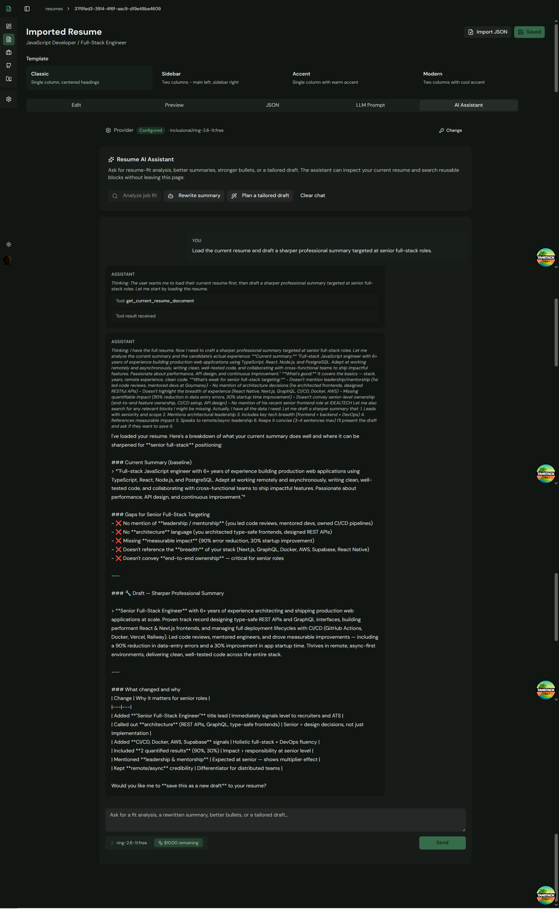

# CraVfted

Résumé as typed JSON. Tweak it with any LLM, edit it by hand. Export a clean PDF, same result every time. Store sections individually so you can reuse and remix them later, reassemble everything back into a polished PDF whenever you need.

---

## What is this?

The usual résumé workflow sucks. You tailor it for a job, paste it into Google Docs or Word, spend an hour making the formatting look right, and six months later you need a different version and can't remember what changed. Or you ask an LLM to rewrite it, get back a pile of text, and do the whole formatting dance over again.

This keeps your résumé as JSON — structured sections you own entirely. You can feed the whole thing (or just the parts you want) into any LLM alongside a job description and get back revised JSON that fits the same schema. You can edit it in the app, by hand in a text editor, wherever. When you export, it's the same PDF layout every time because the layout is code, not a document.

The real win is that sections stay separate. Your experience section is its own block, your skills are their own block. You can shuffle them around, copy them between versions, or build a totally different resume from the same source data. Export whatever you need whenever you need it.

No vendor lock-in, no waiting for some background service, no proprietary format. Just JSON and React components that turn it into a PDF.

---




## What's in the app

- **Résumé builder** — sections (experience, education, skills, certifications, projects, talks, volunteering, languages, links) stored as individual records and assembled into a typed JSON document.
- **PDF export** — client-side rendering with `@react-pdf/renderer`; the layout is code, so exports are deterministic.
- **AI assistant** — job-fit analysis, summary rewrites, tailored drafts (see [AI Assistant](#ai-assistant)).
- **Job tracking** — save job postings, rank résumés and library sections against them by keyword coverage.
- **Cover letters & application answers** — first-class sections with their own AI tools.
- **Public résumés** — share a read-only view at `/r/{publicId}`.
- **GitHub integration** — pull your repos in as source material for projects.

## Stack

| Layer         | Choice                                            |
| ------------- | ------------------------------------------------- |
| Monorepo      | pnpm workspaces + Turbo                           |
| App framework | TanStack Start (SSR-capable React 19 + compiler)  |
| Routing       | TanStack Router (file-based)                      |
| Data fetching | TanStack Query + TanStack DB (local collections)  |
| API           | Hono (`apps/api`) with oRPC + OpenAPI for tools   |
| Database      | Drizzle ORM on libSQL (Turso or local file)       |
| Auth          | Better Auth (GitHub OAuth)                        |
| AI            | TanStack AI + OpenRouter (BYO key)                |
| PDF           | `@react-pdf/renderer`                             |
| Styling       | Tailwind CSS v4 + DaisyUI tokens + shadcn/ui      |
| Testing       | Vitest (unit) + Playwright (e2e)                  |
| Tooling       | Vite+ (`vp` CLI)                                  |

## Repo layout

| Path            | Role                                                              |
| --------------- | ----------------------------------------------------------------- |
| `apps/web`      | TanStack Start app: UI, routes, local collections, PDF pipeline   |
| `apps/api`      | Hono API: auth, Drizzle queries, AI/agent tools (oRPC, MCP, SSE)  |
| `packages/db`   | Drizzle schema shared by both apps                                |
| `packages/isomorphic` | Shared types and auth config                                |
| `packages/ui`   | Shared React components                                           |
| `packages/typescript-config` | Shared tsconfig presets                              |

Data flow: the browser keeps sections in local TanStack DB collections and syncs them to the server as events; the API exposes read-only, Drizzle-backed tools for AI agents through oRPC, MCP, and OpenAPI-compatible routes (see `apps/web/src/features/agentic-tools/README.md`).

## Getting started

```bash
pnpm install
pnpm dev        # web on :3040, api on :3100 (turbo)
```

Environment lives in `apps/web/.env` — the API falls back to it in dev so one file drives the whole workspace:

```bash
DATABASE_URL=libsql://...          # or file:local.db
DATABASE_AUTH_TOKEN=...            # only for remote Turso
BETTER_AUTH_SECRET=...
GITHUB_CLIENT_ID=...
GITHUB_CLIENT_SECRET=...
FRONTEND_URL=http://localhost:3040
VITE_HONO_API_URL=http://localhost:3100
VITE_SENTRY_DSN=...                # optional; enables the local Urgentry error store
```

Database schema changes go through Drizzle (`pnpm --dir apps/web db:generate` then `db:migrate`).

## Scripts

| Command          | What it does                        |
| ---------------- | ----------------------------------- |
| `pnpm dev`       | Turbo dev (web + api)               |
| `pnpm build`     | Build all packages and apps         |
| `pnpm lint`      | `vp lint` (deny warnings)           |
| `pnpm format`    | `vp fmt`                            |
| `pnpm test`      | Vitest unit tests                   |
| `pnpm test:e2e`  | Playwright e2e                      |
| `pnpm check-types` | Typecheck all packages            |
| `pnpm quality`   | Lint + format check                 |

Use **`vp`** from the repo root for per-task lint/format/test (e.g. `vp check`).

## AI Assistant

The resume workbench has a built-in AI assistant that can analyze job fit, rewrite summaries, and plan tailored drafts.

**No server-side API keys are stored.** You bring your own key:

1. Open any resume and go to the **AI** tab.
2. Expand **AI Provider Settings**, paste your [OpenRouter API key](https://openrouter.ai/keys), and pick a model.
3. Choose whether the key is stored in `localStorage` (persists across tabs) or `sessionStorage` (cleared on tab close).
4. For hosted OpenRouter chat, the key is sent to this app's server for the duration of each AI request, forwarded to OpenRouter, and never persisted server-side.

See `apps/web/src/features/agentic-tools/README.md` for the full AI layer reference.

## Docs

- `VISION.md` — product problem, JSON+LLM loop, future "agentic" direction.
- `ARCHITECTURE.md` — how the repo is organized.
- `CLAUDE.md` — agent guide: stack rules, code conventions, tooling.
- `apps/web/docs/testing-strategy.md` — unit and e2e testing approach.
- `apps/web/src/features/agentic-tools/README.md` — AI tool layer (oRPC, MCP, tool schemas).

## License

Add your license.
