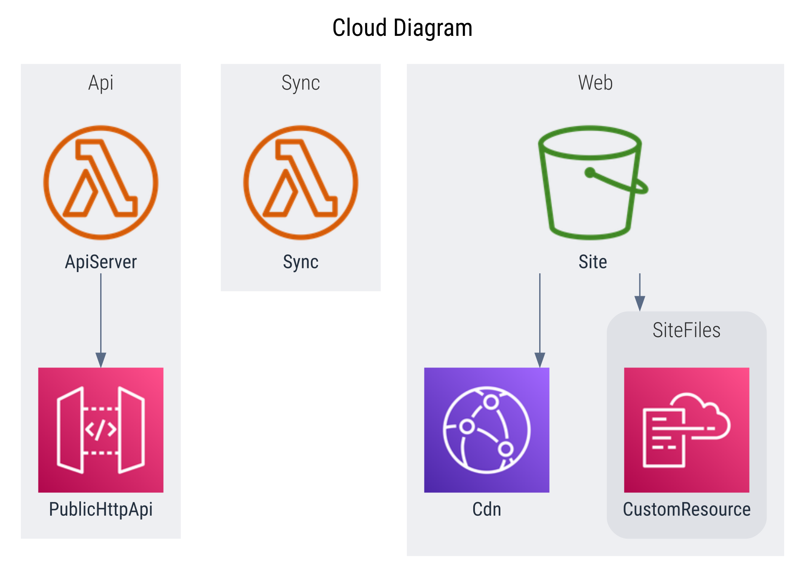

# AWS architecture

This package is the plan for moving the product onto AWS when usage justifies the bill. It is not deployed. The product currently sits at about 10 to 20 users a week, which does not pay for a standing API Gateway, a web function, DynamoDB, CloudFront, and a database. Turso and the current host stay the running system. This CDK app is what `cdk deploy` would build on the day that changes.

Two stacks, on purpose. Sync is its own Lambda in front of a DynamoDB event log. The API is the Hono app in `apps/api`, mounted as a Lambda web function. API Gateway sends `ANY /api/v1` to that function after it rejects a missing or expired JWT and applies the rate limit. The function serves authentication, credits, the waitlist, and the projected tables. Sync Lambda does not open that database. Before it writes or reads the log, it asks the web function whether the user is allowed, by calling the function's own endpoint (`*.lambda-web.<region>.on.aws`) with IAM. That call skips the public gateway and does not use `/api/v1`. A device still uses `GET /api/v1/credit-status`. Code already inside the Hono process calls the credit function directly.

The web app is the other half of a future deploy. CloudFront serves the built files in `apps/web/dist/client`. There is no other frontend work in this package.

Nothing here is applied to an account. `cdk synth` only prints a template. A real deploy needs AWS credentials, the API and web builds, and a decision to start paying.

## When Turso is no longer enough

Aurora is not the cheaper database at this size. Aurora Serverless v2 has a floor of 0.5 ACU, which is on the order of $40 a month before storage, in us-east-1. A small RDS for PostgreSQL instance is closer to $12 a month and is the usual free-tier shape for a year. Aurora earns its place when the database has to grow and shrink without a resize, or when a reader replica is cheaper to add than a second RDS instance. If this product gets there, the swap is Aurora PostgreSQL, and the sync log stays on DynamoDB. The API Lambda keeps the same routes. Only the database URL changes.

`docs/architecture.drawio` is the plan, drawn by hand. The picture below is the CDK app itself. `pnpm --filter @repo/aws build` synthesizes the stacks and rewrites `docs/cdk.png`, so this preview changes when the stacks change.



## Why each piece

| Piece | Choice | Why |
|---|---|---|
| API process | Lambda web function, not a per-request invoke | The Hono app stays open and takes many concurrent requests in one environment. A Lambda proxy integration would start one invoke per request and throw that away. |
| Public front door | API Gateway HTTP API in front of `/api/v1` | The gateway checks the JWT before the web function runs. A missing or expired token is rejected there, so we never call the auth service and never spend a concurrency slot. The gateway also throttles. |
| Client signals | Three different answers | `401` means log in again and get a new JWT. Retrying the same token does nothing. `429` carries `Retry-After`, so the client waits out the rate limit. A credit stop from `GET /api/v1/credit-status` is the payment signal. Upgrading the plan is what changes that, not the throttle header. |
| Sync check | IAM call to the web function endpoint | Sync Lambda asks the same Hono app if the user is allowed, on `*.lambda-web.<region>.on.aws`, with no `/api/v1` and no public gateway. Code inside the Hono process calls the credit function directly. |
| Event log | DynamoDB | The log is an append and a sequence query, not a join. One résumé is about 70 small items. On-demand DynamoDB stays inside the free allowance far past the current 10–20 users a week. |
| Projected tables | A stream materializer, separate from Sync Lambda | DynamoDB Streams invokes a second function that writes the projected tables into Turso (later Aurora or RDS). Sync Lambda never opens that database. A device that only syncs never needs those tables. |
| Site | CloudFront in front of the built web app | The web build is static files. CloudFront serves `apps/web/dist/client`. It is not part of the request path for sync or credits. |

## Run it on Floci

Floci is the local AWS emulator. It does not bill an account. Start the one you already have, point the AWS tools at it, then deploy this package there.

```bash
floci start
eval "$(floci env)"
pnpm --filter @repo/aws exec cdk bootstrap
pnpm --filter @repo/aws exec cdk deploy --all --require-approval never
```

`floci env` sets `AWS_ENDPOINT_URL` to the emulator (port 4566) and dummy credentials. `cdk deploy` then talks to that endpoint. `floci stop` tears the emulator down. The data goes with it unless you started Floci with `--persist`.

Treat a failed resource as a gap in the emulator. Lambda web functions and the HTTP API JWT authorizer may not exist there yet. That is a reason to keep iterating locally, not a reason to deploy this to a paid account.

## Sync log sizing

Rough sizing for the managed sync log. Prices below are us-east-1 list prices: DynamoDB on-demand at $1.25 per million write request units and $0.25 per million read request units, storage at $0.25 per GB-month past the allowance, Lambda at $0.20 per million requests and $0.0000166667 per GB-second.

## What one résumé weighs

A résumé is stored as one event per row, not one event for the whole document.

The projection fixture (`resume-projection-events.json`) is 3 résumés, 208 events, and 73,628 bytes of JSON payloads. That is 354 bytes of payload per event. The standalone résumé document (`real-resume.json`) is 8,534 bytes and expands to about 70 rows: the résumé, a summary, 5 jobs, 20 bullets, education, 3 projects, 2 talks, 5 skill groups, 30 skills, and a couple of links.

| | Count |
|---|---|
| Events to create one résumé | 70 |
| DynamoDB writes to create one résumé | 140 (one `Put` for the event, one `Update` for the per-user sequence counter) |
| Lambda invocations to create one résumé | 1 (the push batch holds 100 events) |
| Reads on that push | 0 (conditional put, no lookup first) |

A cover letter or job description cannot approach the 400 KB DynamoDB item limit. An update stores the new text and the previous text, so the prose would have to be about 200 KB (roughly 30,000 words) before the write failed. A long posting is about 10 KB. 100 KB of English is about 1,000 lines.

Items in the estimates below are counted as 1 KB, which is above the measured payload and still one write request unit.

## Free tier that does not expire

The 12-month account trial is separate. DynamoDB Standard and Lambda keep these monthly allowances for the life of the account, per Region:

| Allowance | Amount | What it does not cover |
|---|---|---|
| DynamoDB storage | 25 GB | Standard-IA, backups, point-in-time recovery |
| DynamoDB provisioned capacity | 25 write units and 25 read units | On-demand requests. Storage is still free up to 25 GB |
| Lambda requests | 1,000,000 | |
| Lambda compute | 400,000 GB-seconds | |

25 provisioned write units is 25 items per second of up to 1 KB, all month, at no charge. The storage cap is what accumulates across the year. The request cap resets every month.

## Usage assumed for one user

"Running it like this" means both of the following, every month:

- They create 20 résumés (1,400 events).
- They type for 8 hours on each of 20 weekdays, and a flush runs every 10 minutes with one changed row. That is 960 flushes. Each flush is one push and one pull.

Per user per month:

| | Count |
|---|---|
| New events kept if nothing is squashed | 2,360 |
| Storage added | 2.30 MB |
| Lambda invocations | 1,934 (960 pushes, 960 pulls, 14 create batches) |
| DynamoDB writes | 4,720 |
| DynamoDB reads | 960 |

If squash keeps only the current row for each key, a user who holds 20 résumés occupies about 1.37 MB and stays there. The 2.30 MB figure is the append-only case, where every keystroke flush is kept for the year.

## How many of those users fit for a year

| Ceiling | Users | Why |
|---|---|---|
| Lambda requests | **517** | 1,000,000 / 1,934 |
| Lambda compute | 4,136 | 256 MB for 200 ms is 0.05 GB-seconds per call |
| DynamoDB storage, append-only for 12 months | 925 | 25 GB / (2.30 MB × 12) |
| DynamoDB storage, squashed to live rows | about 18,700 | 25 GB / 1.37 MB |

**517 users** is the number that stays inside every monthly allowance for the whole year, if every one of them types on that schedule. At 517 users the log grows to about 14 GB by month 12, still under 25 GB. Compute used is about 50,000 GB-seconds of the 400,000. Average write rate at that population is under 1 write per second, against a free 25.

The capacity limit is a burst limit, not an average. If all 517 clients flush in the same second, that is about 1,000 writes at once, and 25 provisioned write units will throttle. Spreading that burst over a minute keeps it free. On-demand mode absorbs the burst and bills it; those requests are not in the free allowance.

Someone who only creates 20 résumés and does not type all day is a different ceiling: storage runs out first, at about **1,560** append-only users after a year. Lambda would allow tens of thousands of them.

## Cost per user once the allowance is used up

Unsubsidized price of one such user for a month, on-demand DynamoDB plus Lambda, with no free units applied:

| | Per user per month |
|---|---|
| DynamoDB writes (4,720 × $1.25 / 1,000,000) | $0.0059 |
| DynamoDB reads (960 × $0.25 / 1,000,000) | $0.0002 |
| Lambda requests | $0.0004 |
| Lambda compute (256 MB, 200 ms) | $0.0016 |
| **Total** | **$0.008** |

About **10 cents per user per year**. Storage past 25 GB adds $0.25 per GB-month, which is under a cent per user per year at 2.30 MB a month.

While the account is under the caps, the marginal cost of another user is $0. The 10 cents is what it costs to keep a user after the free request allowance is exhausted, not a bill you pay on top of the free tier.

## What the stacks deploy

`bin/app.ts` is three stacks. None of them are wired to a live account.

- **Api** bundles `src/api-server.ts`, which serves the Hono app from `@repo/api`. That asset is the Lambda web function. The HTTP API in front of it is the public `/api/v1` proxy (JWT and throttle). It is not a Lambda proxy integration, because that would be one invoke per request and would throw away the web function's concurrency.
- **Sync** is an event function for the log, plus permission to call the web function endpoint with `lambda:InvokeWebFunctionEndpoint`.
- **Web** uploads `apps/web/dist/client` to S3 and puts CloudFront in front of it. Build the web app before a synth that includes this stack.

Local checks, when you want them, are the AWS emulators or a local API Gateway stand-in. They are for proving the handler, not for running the product.

## Architecture

Two stacks. Sync is DynamoDB and Lambda. Everything that queries rows, including projection, wallets, and remote MCP, stays on the existing API. The device never calls Lambda directly.

```
device
  │
  └─ API Gateway  (reject missing or expired JWT)
        │
        ├─ ANY /api/v1                  API Lambda web function (Turso)
        │     mounts the Hono app: authentication, credits,
        │     waitlist, projected tables
        │     GET /api/v1/credit-status → proceed | stop
        │
        └─ if proceed
              POST /sync/events         Sync Lambda → DynamoDB log
              GET  /sync/events         Sync Lambda → DynamoDB log

Sync Lambda
  └─ IAM to the web function endpoint (*.lambda-web.<region>.on.aws)
        allowed?  — no API Gateway, no /api/v1
```

**Sync Lambda.** One function in front of the event log. Push appends events for the session user and returns the new per-user sequence. Pull queries `seq` greater than the cursor. Before either of those, it asks the API Lambda whether this user is allowed to sync. That call goes straight to the web function endpoint with IAM auth. It does not pass through API Gateway, and the path does not include `/api/v1`. The same long-lived Hono process answers it. Sync Lambda still does not open Turso, does not read the wallet itself, and does not project. A device that only syncs never needs the projected tables. "My résumés" is not a query this function can answer; the server only has the log.

**Who calls the web function.** A device uses the public path, `GET /api/v1/credit-status`, through API Gateway. A Lambda in this account, including Sync Lambda, calls `*.lambda-web.<region>.on.aws` with IAM and skips that prefix. Code that is already inside the Hono process calls the credit function directly and skips HTTP.

**API Gateway.** `/api/v1` and the sync event routes both arrive here. The authorizer rejects a call when the JWT is missing or expired. `/api/v1` is one HTTP proxy into the API Lambda. Credit-status is not its own gateway integration.

**Credit gate.** The device can call `GET /api/v1/credit-status` before it syncs, so an empty wallet never starts a sync request. Sync Lambda repeats the check itself: it asks the web function if the user is allowed, and it refuses the push or pull when the answer is no. That is the check that protects the log. Charging still happens in the web function, against the wallet in Turso. The projector no longer decides billing.

**API Lambda.** One web function mounts the Hono app as its handler. API Gateway forwards all of `/api/v1` to it after the JWT check. The function serves authentication, the credit wallet and ledger, the waitlist, and the projected résumé tables. Those tables share one Turso database, and a credit read joins the wallet to the waitlist entry. Splitting them into their own functions would add a cold start and a second database client without a boundary the request needs.

The materializer is the other function in this stack. It is not a web function. DynamoDB Streams invokes it, and it writes the projected tables into the same Turso database the API Lambda reads. Sync Lambda never shares this database.

Turso is enough at this size. Moving the projected tables, wallets, and waitlist to Postgres is a database swap once the row volume or the vector queries outgrow Turso, not a change to the function split or the sync log.
